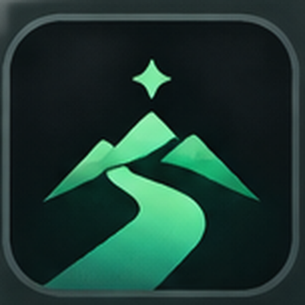

# Stay in Path



**Build consistency. Track progress. Stay in Path.**

A minimal, offline-first Windows application designed to help you build better habits, stay focused, and make meaningful progress toward your goals.

No accounts. No subscriptions. No distractions. Just you and your progress.

---

## What is Stay in Path?

Stay in Path is a personal productivity companion that turns your daily efforts into visible progress.

Inspired by GitHub's contribution graph, it helps you visualize your consistency, build sustainable routines, and stay connected to your long-term goals.

Whether you're learning to code, studying, reading, or working on a personal project, Stay in Path makes every day count.

## Features

**GitHub-Inspired Consistency Heatmap**
- Visualize your daily consistency through a color-coded activity calendar.
- Explore individual heatmaps for each habit.
- Track your current and longest streaks.

**Custom Habit Tracking**
- Create unlimited Yes/No or time-based habits.
- Set your own daily time targets.
- Monitor completion rates and progress over time.
- Rename a habit or change its daily target at any time.
- Archive a habit without losing its history, then restore it or delete it permanently.

**Main Mission**
- Set one important goal to work toward.
- Track milestones and your overall completion percentage.
- Keep your bigger objective visible every day.

**Built-in Focus Timer**
- Start a focused work session directly from the app.
- Automatically record your completed focus minutes.
- Connect focused work with your daily habits.
- An unfinished session survives sleep, crashes and restarts.

**Weekly Performance Review**
- See how consistent you've been throughout the week.
- Review your focus time and habit completion.
- Compare your performance with the previous week.

**Floating Desktop Widget**
- Keep your consistency visible while you work.
- Minimal, dark-themed, and movable.
- Access it from the Windows system tray.

**Refined Interface**
- Dark "control room" look with a slowly drifting aurora background and glass cards.
- Animated rings, counters, bars, heatmap, page transitions and slide-in toasts.
- Motion is deliberately subtle and never blocks input.

## Your Data Stays Yours

Stay in Path is built with privacy in mind.

- 100% offline habit tracking
- No registration required
- No cloud accounts or external tracking
- Personal data stored locally on your computer
- Free and open source

## Download & Installation

**Windows**

1. Visit the [Releases page](https://github.com/akbarpiroglan/stay-in-path/releases).
2. Download `StayInPath.exe` from the latest available release.
3. Save it in a permanent folder and launch the application.
4. Create your first habit and start tracking your consistency.

No Python or coding knowledge required.

*Note: Public releases may be unsigned, and Windows may display a publisher verification warning. Download only from a release you trust.*

## Built for Consistency, Not Perfection

Progress isn't about having a perfect day every day.

It's about showing up consistently, understanding your patterns, and moving forward.

**Small steps. Real progress. Stay in Path.**

---

## Open Source

Stay in Path is an open-source project built with Python, PySide6, and SQLite.

Contributions, feedback, and feature suggestions are welcome.

If you find the project useful, consider giving it a star!

### Run from source

1. Install **Python 3.10–3.15**, enabling the `py` launcher (from [python.org](https://www.python.org/downloads/windows/)).
2. Open the `stay-in-path` folder and double-click **`run_windows.bat`**.
3. The script creates a virtual environment, installs PySide6 and launches the app.

### Developer tests

```sh
python -m unittest discover -s tests -v
```

## License

Distributed under the MIT License. See [LICENSE](LICENSE) for details.

Copyright © 2026 Stay in Path.
